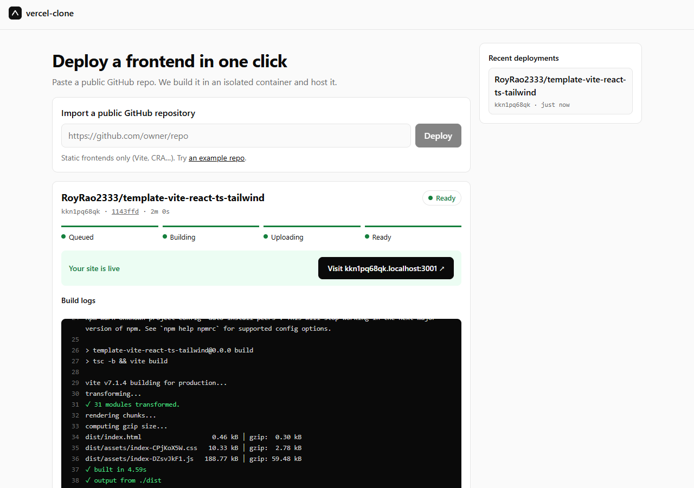

# vercel-clone

Paste a public GitHub repo, and it gets built in an isolated Docker container and hosted at its own subdomain. A learning project that rebuilds the core of Vercel's deploy pipeline.



## How it works

```text
web ──► upload-service ──► Redis stream ──► deploy-service ──► builder container (untrusted)
                                                  │                    │ download @ sha → install → build
                                                  └──── upload ───► S3 dist/<id>/
browser ──► <id>.localhost:3001 ──► request-handler ──► S3
```

- **upload-service** validates the repo with the GitHub API, pins the exact commit SHA, and queues a job.
- **deploy-service** builds each job in a locked-down throwaway container (no secrets, CPU/memory/time limits), then uploads the static output to S3.
- **request-handler** serves each deployment from S3 by subdomain, with SPA fallback and caching.
- **web** is the UI: deploy, watch live build logs, open the site.

Full diagrams and design decisions: **[docs/architecture.md](docs/architecture.md)**.

## Stack

Turborepo · pnpm · TypeScript · Node 24 · Express 5 · Redis Streams (ioredis) · Docker · AWS S3 · Vite + React 19 · zod

## Run it locally

Prerequisites: Node 24+, pnpm, Docker Desktop, an S3 bucket and an IAM user that can read/write it.

```powershell
pnpm install
docker compose up -d                              # Redis
pnpm --filter deploy-service builder:build        # the build sandbox image

# create .env files from the examples and fill in AWS values
copy apps\upload-service\.env.example  apps\upload-service\.env
copy apps\deploy-service\.env.example  apps\deploy-service\.env
copy apps\request-handler\.env.example apps\request-handler\.env

pnpm dev                                          # starts all four apps
```

Then open http://localhost:3000.

| App | URL |
|---|---|
| web | http://localhost:3000 |
| upload-service | http://localhost:3002 |
| request-handler | http://&lt;id&gt;.localhost:3001 |
| deploy-service | (background worker) |

## Limits (v1)

- Public GitHub repos only, up to 100 MB.
- Static frontends only (Vite, CRA, etc.): the build must produce `dist/`, `build/` or `out/` with an `index.html`.
- Builds: 1 CPU, 1 GB RAM, 10-minute timeout.

## Docs

| Doc | Contents |
|---|---|
| [architecture.md](docs/architecture.md) | system, deploy flow, queue, serving, data layout, production plan |
| [phase-0.md](docs/phase-0.md) | monorepo + local infrastructure |
| [phase-1.md](docs/phase-1.md) | upload-service |
| [phase-2.md](docs/phase-2.md) | deploy-service + build sandbox |
| [phase-3.md](docs/phase-3.md) | request-handler |
| [phase-4.md](docs/phase-4.md) | web frontend |
