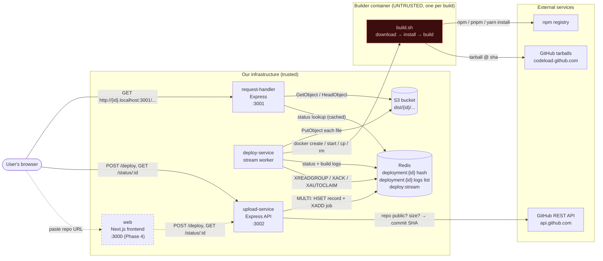
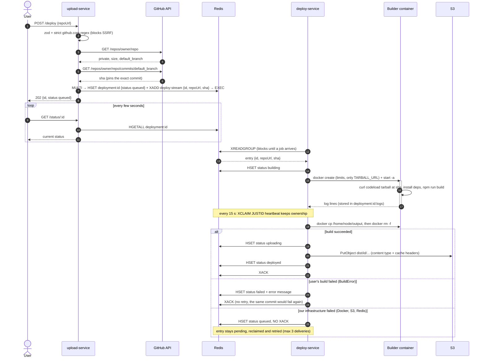
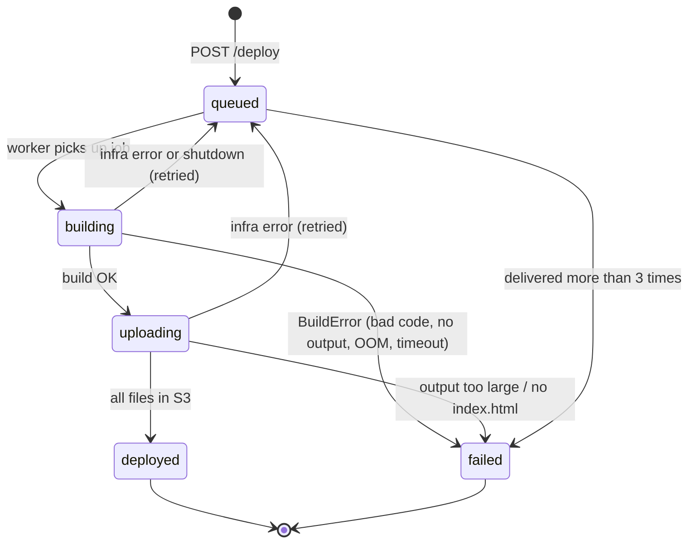
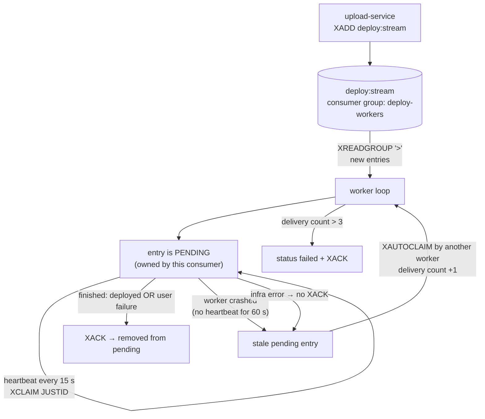
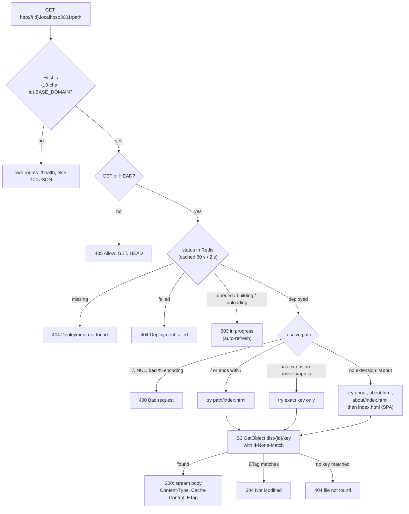
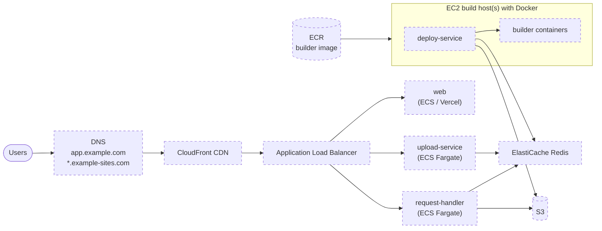

# Architecture

How the Vercel clone works end to end: what each service does, how a deploy flows
through the system, and how a deployed site is served. Diagrams are Mermaid, so
they render on GitHub and in VS Code's Markdown preview.

> Status: Phases 0–3 are implemented (upload-service, deploy-service, request-handler).
> The web frontend (Phase 4) and production hosting (Phase 5) are planned and drawn dashed.

---

## 1. System architecture



### Services

| Service | Port | Role | Talks to |
|---|---|---|---|
| **web** *(Phase 4)* | 3000 | UI: paste a repo URL, watch status + logs, get the link | upload-service |
| **upload-service** | 3002 | Validate the repo, pin the commit SHA, record + enqueue the deployment | GitHub API, Redis |
| **deploy-service** | — | Worker: build each job in a sandbox, upload output, update status | Redis, Docker, S3 |
| **request-handler** | 3001 | Serve `<id>.<domain>` from S3 | Redis, S3 |
| **builder container** | — | Runs ONE untrusted build, then is deleted | GitHub tarballs, npm |

### Trust boundaries

| | Our services | Builder container |
|---|---|---|
| Runs whose code? | ours | **the user's** (install scripts, build script) |
| AWS credentials | ✅ (env locally, IAM role in prod) | ❌ never |
| Redis access | ✅ | ❌ |
| Host filesystem | ✅ | ❌ no bind mounts; output leaves only via `docker cp` |
| Limits | — | 1 CPU, 1 GB RAM, 512 pids, no capabilities, no-new-privileges, timeout |

---

## 2. Deploy flow (one deployment, start to finish)



### Deployment status lifecycle



---

## 3. The job queue (Redis Streams, no BullMQ)



Why each piece exists:

| Mechanism | Prevents |
|---|---|
| Consumer group | two workers building the same deployment |
| Pending list + XACK | losing a job when a worker crashes mid-build |
| XAUTOCLAIM after 60 s idle | a crashed worker's job waiting forever |
| Heartbeat (XCLAIM JUSTID) | a healthy long build being stolen by another worker |
| Delivery count limit (3) | one poison job retrying forever |
| `MULTI` (HSET + XADD) | a status record without a job, or a job without a record |
| Commit SHA in the job | building different code than what was validated (TOCTOU) |
| `MAXLEN ~ 10000` | the stream growing forever |

---

## 4. Serving a deployed site (request-handler)



Caching strategy (set by deploy-service at upload, forwarded by request-handler):

| File | Cache-Control | Why |
|---|---|---|
| `*.html` | `no-cache` | always revalidate, so a new deploy shows up |
| `assets/*` | `public, max-age=31536000, immutable` | Vite puts a content hash in the filename |
| everything else | `public, max-age=3600` | favicons, images without hashes |

---

## 5. Data layout

### Redis

| Key | Type | Written by | Read by | Contents |
|---|---|---|---|---|
| `deployment:<id>` | hash | upload-service, deploy-service | upload-service, request-handler | `id, repoUrl, sha, status, createdAt, updatedAt, error?` |
| `deployment:<id>:logs` | list | deploy-service | (web, Phase 4) | last 1000 build log lines, 7-day TTL |
| `deploy:stream` | stream | upload-service | deploy-service | `{id, repoUrl, sha}` per entry |

### S3 (`vercel-clone-chaitanya`, us-east-1)

```text
dist/
  <id>/
    index.html
    assets/index-<hash>.js
    assets/index-<hash>.css
    vite.svg
```

---

## 6. Repository layout

```text
apps/
  upload-service/    Express API: POST /deploy, GET /status/:id
  deploy-service/    stream worker + builder/ (Dockerfile, build.sh)
  request-handler/   serves <id>.<BASE_DOMAIN> from S3
  web/               (Phase 4) Next.js frontend
packages/
  shared/            constants, types, zod schemas, stream encoding
  typescript-config/ shared tsconfig presets
  eslint-config/     shared ESLint config
docs/                phase plans + this file
docker-compose.yml   local Redis
```

---

## 7. Production topology (planned, Phase 5)



Notes for production:

- **Serve user sites from a separate domain** (like `vercel.app` vs `vercel.com`). User sites on subdomains of the main app's domain could read or set cookies for the app.
- **deploy-service needs a Docker daemon**, so it runs on EC2, not plain Fargate. To make builds serverless, swap `apps/deploy-service/src/docker.ts` for ECS `RunTask`; nothing else changes.
- **IAM roles, not keys.** upload-service needs no AWS access. deploy-service needs `PutObject` on `dist/*`. request-handler needs `GetObject` + `ListBucket` (without `ListBucket`, missing files return 403 instead of 404).
- **CloudFront in front of request-handler** caches `immutable` assets at the edge, so most requests never reach our servers.
